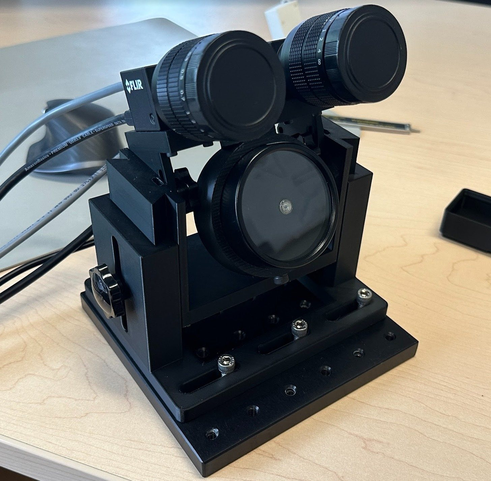

# Welcome to OpenIris!

OpenIris is an adaptable and user-friendly open-source framework for video-based eye-tracking by [Ocular-Motor lab \@ UC Berkeley](https://omlab.berkeley.edu/). It is developed in C# with a modular design that allows further extension and customization through plugins for different hardware systems, tracking, and calibration pipelines. It can be remotely controlled via a network interface from other devices or programs. Eye movements can be recorded online from (up to 4) camera streams or offline post-processing recorded videos. Example plugins have been developed to track pupil, corneal reflections, and torsion to capture eye motion in 3-D. Binocular pupil tracking pipelines that have been implemented can achieve frame rates of more than 500Hz. 

OpenIris has a user-friendly graphical interface, basic tracking algorithm, and example pipeline for a quick start. OpenIris already implements a set of core features common to most eye-tracking systems. This architecture allows plugin developers to focus on the image processing techniques for tracking or the hardware integration without the need to implement the often more tedious requirements involving user interface, real-time multithreading, data storage, error handling, and configuration.

  
   
  <em>A desktop eye tracker for OpenIris: two FLIR Blackfly S cameras and an infrared illuminator on a 3D-printed mount. See <a href="https://omlab.berkeley.edu/OpenIris/user-manual/hardware/">Hardware</a> for the parts.</em>

# Quick Start
>[!NOTE]
> OpenIris can only work on Windows 10 or later versions (for now!)

To quickly install and check OpenIris features, download [the latest version of the application](https://github.com/ocular-motor-lab/OpenIris/releases).
- Download the release zip file in the desired directory
- Unzip the folder
- Inside the release folder, open the openiris.exe file
- The openiris main window will open. Select "Simulation" from the "Eye Tracking System" menu (default option) and hit Start Tracking.
- The default pupil, corneal reflection, and torsion tracking pipeline will start.

This is just an example video. To explore all the great features of OpenIris, please read the [documentation](https://omlab.berkeley.edu/OpenIris/).

# Documentation

The documentation is at **[omlab.berkeley.edu/OpenIris](https://omlab.berkeley.edu/OpenIris/)** (also readable here, in [docs](docs/README.md)):

- **[User manual](docs/user-manual/README.md)**: installing, configuring, recording, calibrating, processing videos, controlling OpenIris from MATLAB, Python or your stimulus program, and the hardware we use.
- **[Plugin development](docs/plugin-development/README.md)**: how OpenIris works, writing plugins for new cameras, tracking methods and calibrations, building from source, and contributing.

> [!TIP]
> With versions before 0.1.6, Windows may block the plugins: the "Eye Tracking System" menu then shows only a few options. Before unzipping, right-click the zip file, select Properties, check "Unblock" and hit OK. See [Installation](docs/user-manual/installation.md#versions-before-016-unblock-the-plugins) for details.

### Help Shape the Future of Open Iris Eye-Tracking
We are excited to invite you to contribute to Open Iris, an innovative open-source eye-tracking framework that is transforming the field of vision research and human-computer interaction. By participating in this collaborative project, you have the opportunity to work with a passionate community of developers, researchers, and enthusiasts dedicated to advancing eye-tracking technology. Whether you are a seasoned programmer, a UX designer, a researcher, or simply someone with a keen interest in eye tracking, your unique skills and insights are invaluable to us. Join us in pushing the boundaries of what is possible, enhancing accessibility, and creating cutting-edge solutions that benefit everyone. Together, we can make OpenIris the premier platform for eye-tracking development and research.

See [CONTRIBUTING.md](CONTRIBUTING.md) to get started.

### Cite
If you use OpenIris, please cite the OpenIris paper in your publication:

Roksana Sadeghi, Ryan Ressmeyer, Jacob Yates, and Jorge Otero-Millan. 2024. Open Iris - An Open Source Framework for Video-Based Eye-Tracking Research and Development. In Proceedings of the 2024 Symposium on Eye Tracking Research and Applications (ETRA '24). Association for Computing Machinery, New York, NY, USA, Article 17, 1–7. [https://doi.org/10.1145/3649902.3653348](https://doi.org/10.1145/3649902.3653348)

### Synchronization  of eye data with stimulus display
https://github.com/ocular-motor-lab/OpenIrisSync/wiki

### License
OpenIris is licensed under the [GNU Affero General Public License v3.0](LICENSE).

OpenIris uses third-party components under their own licenses, notably [Emgu CV](https://www.emgu.com/) (GNU GPL v3, or a commercial license from Emgu Corporation) and the camera vendors' SDKs (FLIR Spinnaker and FlyCapture, and others), which are subject to their vendors' terms.

