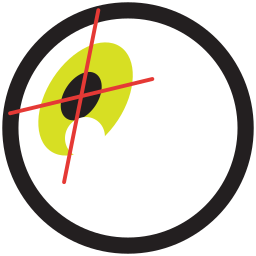

<h1>OpenIris</h1>

Open-source, high-speed video eye tracking for research, from the
<a href="https://omlab.berkeley.edu/">Ocular Motor Lab</a> at UC Berkeley.

[Get started](user-manual/installation.md){ .md-button .md-button--primary }
[User manual](user-manual/README.md){ .md-button }
[Write a plugin](plugin-development/creating-a-plugin.md){ .md-button }

-   :material-eye-outline:{ .lg } **Binocular tracking at 500 Hz**

    ---

    Pupil, corneal reflections and torsion of both eyes, tracked in real time, with every frame
    recorded.

-   :material-camera-outline:{ .lg } **Your cameras**

    ---

    Synchronized FLIR cameras, webcams and other systems through plugins. Try it without a camera
    with the built-in [simulation](user-manual/installation.md#first-run-the-simulation-system).

-   :material-remote:{ .lg } **Control it from your experiment**

    ---

    Start and stop recordings, mark events, read the eye position and run calibrations from
    MATLAB, Python or any [stimulus program](user-manual/remote-control.md).

-   :material-video-outline:{ .lg } **Record and reprocess**

    ---

    Save the raw videos and [process them again](user-manual/processing-videos.md) later, with
    different settings or a better calibration.

-   :material-puzzle-outline:{ .lg } **Extensible**

    ---

    Add cameras, tracking methods and calibrations as [plugins](plugin-development/README.md),
    without changing OpenIris. See the [recommended plugins](user-manual/plugins.md).

-   :material-hammer-wrench:{ .lg } **Build your own tracker**

    ---

    [Parts lists](user-manual/hardware.md), infrared illumination, camera synchronization and
    3D-printable mounts.

## Cite OpenIris

If you use OpenIris in your research, please cite:

Roksana Sadeghi, Ryan Ressmeyer, Jacob Yates, and Jorge Otero-Millan. 2024. Open Iris - An Open
Source Framework for Video-Based Eye-Tracking Research and Development. In *Proceedings of the 2024
Symposium on Eye Tracking Research and Applications (ETRA '24)*. Article 17, 1–7.
[doi:10.1145/3649902.3653348](https://doi.org/10.1145/3649902.3653348)

OpenIris is open source, under the [GNU AGPL v3](https://github.com/ocular-motor-lab/OpenIris/blob/main/LICENSE),
and developed on [GitHub](https://github.com/ocular-motor-lab/OpenIris). Questions and ideas are
welcome in [Discussions](https://github.com/ocular-motor-lab/OpenIris/discussions).
