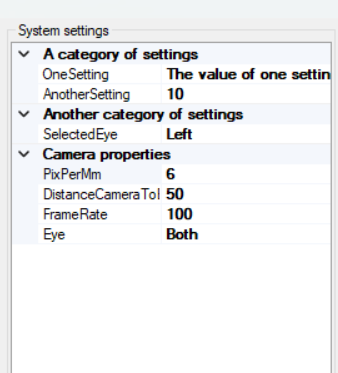

# Creating a plugin

A plugin is a DLL that OpenIris loads at startup from its `Plugins` folder. It can add:

- an **eye tracking system**: a camera or a set of cameras ([Eye tracking systems](eye-tracking-systems.md));
- a **tracking pipeline**: how each image is processed ([Tracking pipelines](tracking-pipelines.md));
- a **calibration**: how eye positions become gaze angles ([Calibration pipelines](calibration-pipelines.md)).

One DLL can contain several of them. Each class marked with the right attribute shows up in the
configuration window, and its settings get their own column there, saved with the rest of the
settings.

You can write a plugin in its own project, outside OpenIris (described here), or inside the OpenIris
solution (see the end of this page).

## A plugin project

Plugins are .NET Framework 4.8 class libraries for x64. This project file builds a plugin straight
into the `Plugins` folder of an OpenIris installation:

```xml
<Project Sdk="Microsoft.NET.Sdk">
  <PropertyGroup>
    <TargetFramework>net48</TargetFramework>
    <PlatformTarget>x64</PlatformTarget>
    <LangVersion>9.0</LangVersion>
    <Nullable>enable</Nullable>
    <!-- Folder where OpenIris is installed (the one with OpenIris.exe). -->
    <OpenIrisFolder>C:\OpenIris\</OpenIrisFolder>
    <!-- Build straight into OpenIris's Plugins folder. -->
    <OutputPath>$(OpenIrisFolder)Plugins\</OutputPath>
    <AppendTargetFrameworkToOutputPath>false</AppendTargetFrameworkToOutputPath>
  </PropertyGroup>
  <ItemGroup>
    <!-- Private=false: OpenIris already has these, don't copy them into Plugins. -->
    <Reference Include="OpenIrisLib" HintPath="$(OpenIrisFolder)lib\OpenIrisLib.dll" Private="false" />
    <Reference Include="System.ComponentModel.Composition" />
    <!-- Only for plugins with windows or panels: -->
    <Reference Include="OpenIrisWinForms" HintPath="$(OpenIrisFolder)lib\OpenIrisWinForms.dll" Private="false" />
    <Reference Include="System.Windows.Forms" />
    <!-- Same EmguCV version as OpenIris. Compile against it only: OpenIris provides it at run time.
         Add Emgu.CV.Bitmap (images to System.Drawing bitmaps) or Emgu.CV.UI (image box) the same way
         if the plugin uses them. -->
    <PackageReference Include="Emgu.CV" Version="4.12.0.5764" IncludeAssets="compile" />
  </ItemGroup>
</Project>
```

Change `OpenIrisFolder` to your OpenIris folder. Things to keep:

- **The EmguCV version must match OpenIris's.** The version OpenIris uses is in
  `source\Directory.Packages.props`. If your plugin needs other NuGet packages, OpenIris must not
  already use a different version of them.
- **Don't copy OpenIris's own DLLs into `Plugins`** (`Private="false"`, `IncludeAssets="compile"`).
  Two copies of the same library cause hard-to-understand errors.

### Debugging the plugin in OpenIris

To start OpenIris when you press F5 in Visual Studio, add `Properties\launchSettings.json` to the
project:

```json
{
  "profiles": {
    "OpenIris": {
      "commandName": "Executable",
      "executablePath": "C:\\OpenIris\\OpenIris.exe",
      "workingDirectory": "C:\\OpenIris"
    }
  }
}
```

Breakpoints in your plugin then work as usual.

> [!TIP]
> If your plugin doesn't appear in OpenIris, check the log (Log tab) for errors loading plugins. A
> DLL downloaded from the internet may be blocked by Windows: right-click it, **Properties**, check
> **Unblock**.

## Inside the OpenIris solution

To add a plugin to OpenIris itself, add a class library project to `source\OpenIris.sln` and copy the
setup of an existing plugin project such as `BasicPlugins\BasicPlugins.csproj`:

```xml
<Project Sdk="Microsoft.NET.Sdk">
  <PropertyGroup>
    <OutputType>Library</OutputType>
    <OutputPath>$(OpenIrisPluginsDir)</OutputPath>
  </PropertyGroup>
  <ItemGroup>
    <Reference Include="System.ComponentModel.Composition" />
    <Reference Include="System.Windows.Forms" />
  </ItemGroup>
  <ItemGroup>
    <PackageReference Include="Emgu.CV" />
  </ItemGroup>
  <ItemGroup>
    <ProjectReference Include="..\OpenIrisLib\OpenIrisLib.csproj">
      <Private>False</Private>
    </ProjectReference>
    <!-- Only for plugins with windows or panels. -->
    <ProjectReference Include="..\OpenIrisWinForms\OpenIrisWinForms.csproj">
      <Private>False</Private>
    </ProjectReference>
  </ItemGroup>
</Project>
```

The target framework, platform, language version and package versions come from the shared files in
`source\` (see [Building](building.md#whats-in-the-solution)). `$(OpenIrisPluginsDir)` is the
`Plugins` folder of the build.

## How OpenIris finds plugins

OpenIris uses MEF (`System.ComponentModel.Composition`). At startup it looks at every DLL in
`Plugins` for classes exported with one of these attributes:

| Plugin | Base class | Attribute |
| --- | --- | --- |
| Eye tracking system | `EyeTrackingSystemBase` | `[Export(typeof(EyeTrackingSystemBase)), PluginDescriptionEyeTrackingSystem("Name", typeof(SettingsClass))]` |
| Tracking pipeline | `EyeTrackingPipelineBase` | `[Export(typeof(EyeTrackingPipelineBase)), PluginDescription("Name", typeof(SettingsClass))]` |
| Calibration | `CalibrationPipelineBase` | `[Export(typeof(CalibrationPipelineBase)), PluginDescription("Name", typeof(SettingsClass))]` |

The name is what users see in the configuration window, and it is saved in their settings, so don't
change it once people use the plugin.

## Settings

Each plugin has a settings class, given in its attribute. OpenIris shows its public properties in the
configuration window and saves them in the active settings profile. Inherit from the settings class of
that kind of plugin (`EyeTrackingSystemSettings`, `EyeTrackingPipelineSettings` or
`CalibrationSettings`) and write every property following this pattern:

```csharp
public class EyeTrackingSystemExampleSettings : EyeTrackingSystemSettings
{
    public EyeTrackingSystemExampleSettings()
    {
        // Use the constructor to change the default values of inherited settings.
        Eye = Eye.Both;
        PixPerMm = 2;
    }

    [Category("Camera"), Description("Index of the camera to use.")]
    public int CameraIndex { get => cameraIndex; set => SetProperty(ref cameraIndex, value, nameof(CameraIndex)); }
    private int cameraIndex = 0; // Default value

    [Category("Camera"), Description("Gain of the camera.")]
    public float Gain { get => gain; set => SetProperty(ref gain, value, nameof(Gain)); }
    private float gain = 10f; // Default value
}
```

`SetProperty` notifies OpenIris of changes, so the configuration window and any code listening stay up
to date.



Optional attributes on a property:

- `[NeedsRestarting]`: changing it while tracking stops the tracking, so it takes effect at the next
  start (for example a frame rate the camera only reads when it starts). Don't put it on settings your
  own code changes while starting.
- `[ReadOnly(true)]`: shown but not editable.
- `[Browsable(false)]`: saved but not shown.
