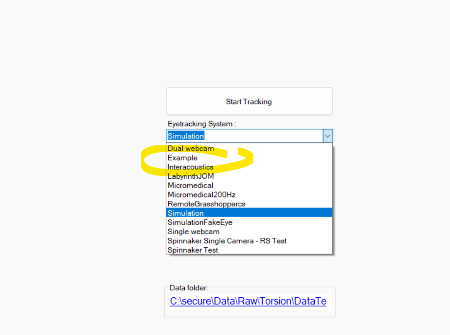

# Eye tracking systems (camera plugins)

An eye tracking system tells OpenIris how to get images: which cameras to open, how to start them,
and how to read the videos they record. It has two parts:

1. a **camera class** (inherits `CameraEye`), one object per camera, that delivers images;
2. an **eye tracking system class** (inherits `EyeTrackingSystemBase`) that creates and starts the
   cameras, and optionally prepares the images and adds data.

See [Creating a plugin](creating-a-plugin.md) first for the project setup. Good examples in the
source code are `SpinnakerInterface` (FLIR cameras, one or two synchronized) and
`OpenIrisLib\EyeTrackingSystems\EyeTrackingSystemSimulation.cs` (plays videos as if they were
cameras).

## 1. The camera class

Inherit from `CameraEye` and implement `Start`, `Stop` and `GrabImageFromCamera`:

```csharp
using System.Drawing;
using Emgu.CV;
using Emgu.CV.CvEnum;
using Emgu.CV.Structure;
using OpenIris;

public class CameraEyeExample : CameraEye, IMovableImageEyeSource
{
    private readonly VideoCapture camera;
    private ulong frameCounter;

    public CameraEyeExample(int cameraIndex)
    {
        // Open the camera, but do not start grabbing images here.
        camera = new VideoCapture(cameraIndex);
    }

    public override void Start()
    {
        frameCounter = 0;

        // OpenIris needs the frame size and frame rate once the camera is started.
        FrameSize = new Size(
            (int)camera.GetCaptureProperty(CapProp.FrameWidth),
            (int)camera.GetCaptureProperty(CapProp.FrameHeight));
        FrameRate = camera.GetCaptureProperty(CapProp.Fps);

        // Start the camera here if its API needs it.
    }

    public override void Stop()
    {
        // Stop the camera. If GrabImageFromCamera may be blocked waiting for an image (common in
        // camera APIs), this must make it return.
    }

    protected override ImageEye GrabImageFromCamera()
    {
        // Called in a loop, on its own thread, for every image. It must be FAST: anything slow here
        // makes OpenIris drop frames.
        using var frame = camera.QueryFrame();
        var image = frame.ToImage<Gray, byte>();

        frameCounter++;
        var timestamp = new ImageEyeTimestamp(
            seconds: EyeTrackerDebug.TimeElapsed.TotalSeconds, // Ideally the camera's own clock
            frameNumber: frameCounter,                         // Starts at 1, matches between cameras
            frameNumberRaw: frameCounter);                     // The camera's own frame counter

        return new ImageEye(image, WhichEye, timestamp, null);
    }

    protected override void Dispose(bool disposing)
    {
        if (disposing) camera.Dispose();
        base.Dispose(disposing);
    }

    // Optional: IMovableImageEyeSource, for cameras whose region of interest can move.
    public void Center(PointF center) { /* Move the ROI to center it on this point */ }
    public void Move(MovementDirection direction) { /* Move the ROI one step */ }
}
```

> [!IMPORTANT]
> **Timestamps and frame numbers** matter, especially with several cameras:
>
> - `Seconds` must always increase, but may start at any value. Use the camera's own clock when its
>   API provides one, rather than the computer's.
> - `FrameNumber` must start at 1 and increase by 1 for every image the camera captured, so OpenIris
>   can count dropped frames.
> - With several cameras, images taken at the same time must have the **same** `FrameNumber`.
>   OpenIris uses it to pair the images of the two eyes, and expects that occasionally a frame is
>   dropped by one camera and not the other. Making the numbers match is the eye tracking system's
>   job, when it creates and starts the cameras.
> - `FrameNumberRaw` is the camera's own counter. It does not need to match between cameras.

Other optional members:

- `ImageEye.ImageSourceData`: any object attached to an image (for example values the camera sends
  with it). It travels with the image through processing, and the eye tracking system can read it in
  `PostProcessImagesAndData` (see below).
- `IVariableExposureImageEyeSource`: implement it if the camera's exposure can be changed from the
  user interface.
- `Info`: any object; its text is shown in the Debug tab.
- `GetCameraTime()`: the current time of the camera's clock, if it has one.

## 2. The eye tracking system class

```csharp
using System.ComponentModel.Composition;
using OpenIris;

[Export(typeof(EyeTrackingSystemBase)), PluginDescriptionEyeTrackingSystem("Example", typeof(EyeTrackingSystemExampleSettings))]
public class EyeTrackingSystemExample : EyeTrackingSystemBase
{
    private CameraEyeExample? camera;

    protected override EyeCollection<CameraEye?>? CreateAndStartCameras()
    {
        var settings = (EyeTrackingSystemExampleSettings)Settings;

        camera = new CameraEyeExample(settings.CameraIndex)
        {
            // Whether the camera sees both eyes, the left or the right one.
            WhichEye = settings.Eye,
            // How the camera is mounted. Images are flipped and rotated accordingly.
            CameraOrientation = CameraOrientation.Upright,
        };

        // Start the cameras here, so that several cameras can be started in sync.
        camera.Start();

        return settings.Eye switch
        {
            Eye.Left => new EyeCollection<CameraEye?>(camera, null),
            Eye.Right => new EyeCollection<CameraEye?>(null, camera),
            _ => new EyeCollection<CameraEye?>(camera),
        };
    }

    public override void Dispose()
    {
        // OpenIris does not stop or dispose the cameras itself: do it here. This runs when tracking
        // stops, also when starting failed halfway, so be ready for cameras that never started.
        camera?.Stop();
        camera?.Dispose();
        camera = null;
    }
}
```

`EyeTrackingSystemExampleSettings` is the settings class (see
[Settings](creating-a-plugin.md#settings)). It inherits from `EyeTrackingSystemSettings`, which
already has the settings common to all systems: `Eye`, `FrameRate`, `PixPerMm`,
`DistanceCameraToEyeMm`.

`CreateAndStartCameras` returns one camera for both eyes (`new EyeCollection<CameraEye?>(camera)`),
or one per eye (`new EyeCollection<CameraEye?>(left, right)`, with `null` for an eye without camera).

### Optional methods

| Method | Use it to |
| --- | --- |
| `PreProcessImages(images)` | Prepare the images before processing. Most often: split the image of one camera that sees both eyes into one image per eye (see below). Also called for videos. |
| `PostProcessImagesAndData(imagesAndData)` | Add data to each frame after processing, for example fill `imagesAndData.Data.ExtraData` with values from `ImageSourceData`. The extra data is saved in the data file and sent to [remote clients](../user-manual/remote-control.md). |
| `CreateVideos(fileNames)` | Open the videos recorded with this system, if they need something special. Return your own class inheriting `VideoEye` and override `GrabImageEyeFromVideo`, for example to read timestamps the camera embeds in the pixels (see `FlyCaptureInterface\ImageGrabbing\VideoEyeFlyCapture.cs`). |
| `CreateHeadDataSourceWithCameras()`, `CreateHeadDataSourceWithVideos()` | Provide head movement data, for systems with a head sensor. |
| `OpenEyeTrackingSystemUI` | Return a window with controls specific to this system. |
| `GetToolStripMenuItems()` | Add items to the menu (see below). |
| `SaveCameraMove()`, `SaveCameraExposure()` | Save the camera position or exposure in the settings after the user changes them, so they are kept for the next session. |

Splitting the image of one camera into one image per eye:

```csharp
public override EyeCollection<ImageEye?> PreProcessImages(EyeCollection<ImageEye?> images)
{
    var image = images[Eye.Both];
    if (image is null) return images;

    var width = image.Size.Width / 2;
    var left = image.Copy(new Rectangle(width, 0, width, image.Size.Height));
    var right = image.Copy(new Rectangle(0, 0, width, image.Size.Height));
    left.WhichEye = Eye.Left;
    right.WhichEye = Eye.Right;

    return new EyeCollection<ImageEye?>(left, right);
}
```

Adding a menu item:

```csharp
public override ToolStripMenuItem[]? GetToolStripMenuItems()
{
    var item = new ToolStripMenuItem { Text = "Example action", ShortcutKeys = Keys.F11 };
    item.Click += (o, e) => MessageBox.Show("Example action");
    return new[] { item };
}
```

## 3. Try it

Start OpenIris. The new system appears in the **Eye tracking system** list on the main window and in
the configuration window.


