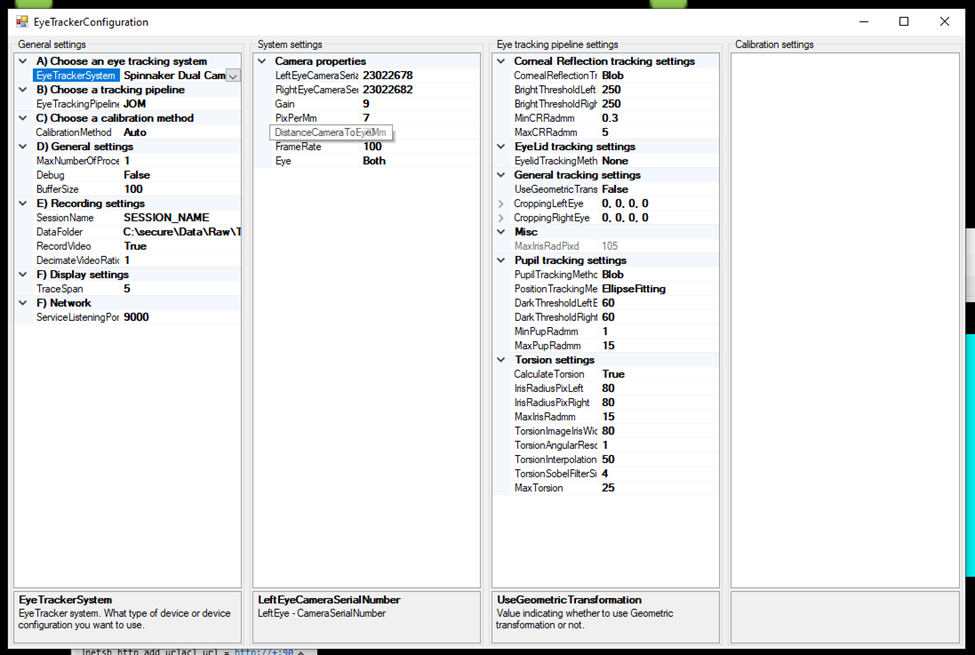

# Configuration

Open the configuration window with **File > Configuration…**. It has four columns:

1. **General settings**: which system, pipeline and calibration to use, and how to record.
2. **System settings**: the settings of the selected eye tracking system (the cameras).
3. **Eye tracking pipeline settings**: how the images are processed.
4. **Calibration settings**: the settings of the selected calibration method.

Click a setting to see its description at the bottom of the column. Settings are saved automatically
in `EyeTrackerSettings.xml`, in the OpenIris folder, and kept for the next session.

Some settings can only change while not tracking, for example the camera frame rate. Changing one of
them while tracking stops the tracking; start it again to apply the change.

## General settings

| Section | Setting | Notes |
| --- | --- | --- |
| A | **EyeTrackerSystem** | The cameras, or Simulation. Same as the list on the main window. |
| B | **EyeTrackingPipeline** | How images are processed. **JOM** is the full pipeline (pupil, corneal reflections, eyelids, torsion). |
| C | **CalibrationMethod** | See [Calibration](calibration.md). |
| D | **MaxNumberOfProcessingThreads** | How many frames are processed at the same time. 2 works best in most cases. |
| D | **Debug** | Shows intermediate images in the Debug tab. Keep it **False** while recording: it slows processing, and at high frame rates OpenIris drops frames. |
| D | **BufferSize** | How many frames can wait to be processed before frames are dropped. |
| E | **SessionName** | Name of the recording files. Can also be changed on the main window. |
| E | **DataFolder** | Where recordings are saved (default `C:\OpenIrisData`). |
| E | **RecordVideo** | Whether recordings include the raw video of the eyes (default off). Videos let you [process the recording again](processing-videos.md) later, but take a lot of disk space. |
| E | **DecimateVideoRatio** | Record one of every N frames in the video: 1 records every frame, 2 every other frame, 5 one of every 5. The data file still has every frame. |
| F | **TraceSpan** | How many seconds the traces in the Viewer tab show. |
| G | **ServiceListeningPort** | First network port for [remote control](remote-control.md) (default 9000). |

## System settings

These depend on the eye tracking system. For the Spinnaker (FLIR) systems:

- **Serial numbers**: which camera is which eye. If left and right are swapped, swap the numbers.
- **FrameRate**: FLIR cameras can record up to 500 Hz. OpenIris can track the pupil and corneal
  reflection and save videos at 500 Hz; with torsion, up to about 250 Hz without dropping frames.
- **Gain**: when increasing the frame rate, the exposure time gets shorter, so increase the gain to
  keep the image bright enough.
- **PixPerMm**: how many pixels per millimeter in the image. A larger value expects a larger iris.

## Eye tracking pipeline settings

For the JOM pipeline:

- **Corneal reflections**: choose **Blob** to track them.
- **Pupil tracking method**: Blob with Convex-Hull works well at 500 Hz.
- **CroppingLeftEye**, **CroppingRightEye**: margins of the image to ignore, if something at the
  edges confuses the tracking.
- **CalculateTorsion**: turns torsion tracking on or off. Torsion takes the most processing time.
- **Eyelid tracking**: not reliable in the current version; we recommend leaving it off.

The most used thresholds (pupil, reflection, iris radius) are also available as sliders under each
eye image on the main window.
