# Hardware

This page lists the equipment we use with OpenIris and how we put it together. Other cameras can be
supported with a plugin (see the [plugin development manual](../plugin-development/eye-tracking-systems.md)).

## Recommended equipment

| Part | What we use |
| --- | --- |
| Cameras | Two FLIR [Blackfly S BFS-U3-16S2M](https://www.flir.com/products/blackfly-s-usb3/?model=BFS-U3-16S2M-CS) (USB 3, monochrome), one per eye. |
| Lenses | 50 mm f/1.4 C-mount CCTV lenses ([example](https://www.amazon.com/dp/B089Q1BN7X)). |
| Spacers | 5 mm C to CS mount adapter rings ([example](https://www.amazon.com/dp/B01FY70S4G)). |
| IR filter | [2" x 2" optical cast plastic IR longpass filter](https://www.edmundoptics.com/p/2quot-x-2quot-optical-cast-plastic-ir-longpass-filter/5422), cut to replace the glass of the camera (see below). Alternatively, a filter that fits your lens. |
| IR illuminator | [Tendelux AI4 IR illuminator](https://www.amazon.com/dp/B075ZYG89D), or an IR flashlight adapted to a power adapter (see below). |

## Adding an IR pass filter to Blackfly S cameras

We put the IR filter right in front of the camera sensor, replacing the camera's protective glass.
That way the filter works with any lens; filters for the outside of the lens depend on each lens's
size. If you always use the same lens, a filter on the lens is also fine.

1. Cut the filter into 14 x 14 mm pieces: score it with a knife several times, then carefully snap it
   with pliers, holding it with a soft tissue in between (lens cleaning wipes work well).

   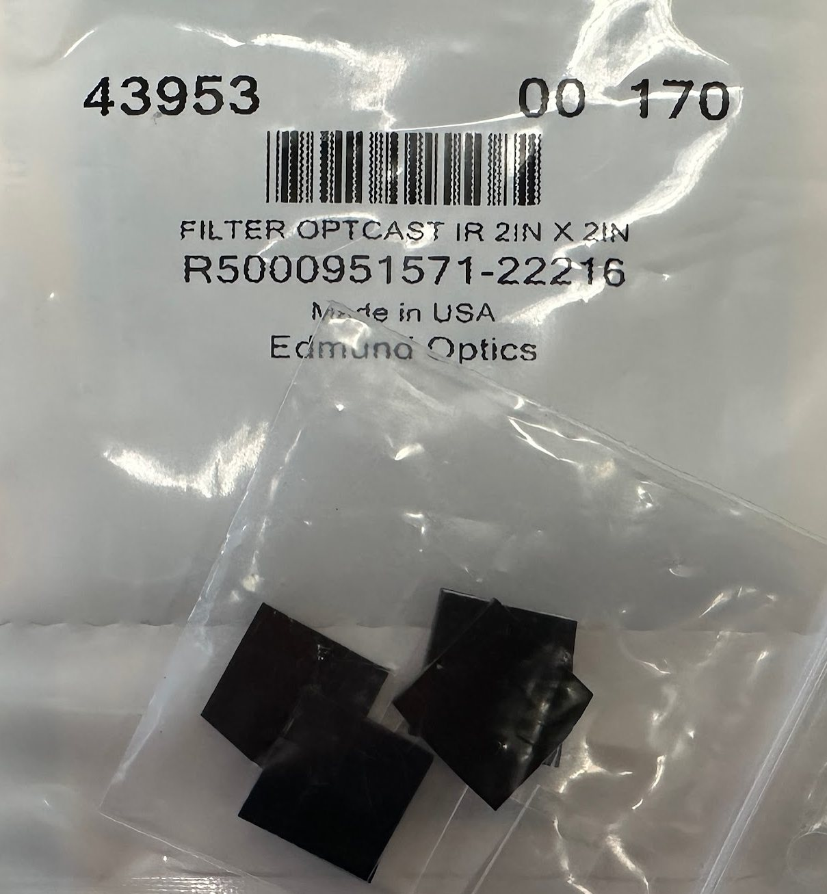

2. Remove the two screws holding the ring in front of the sensor, remove the ring and then the glass.
3. Put in the filter quickly, so dust doesn't get in, and screw the ring back. It doesn't need to be
   perfectly in place before screwing; it usually settles while you screw.

   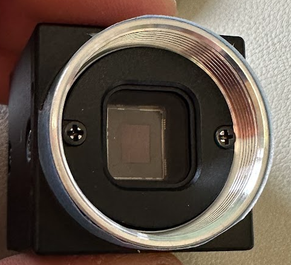
   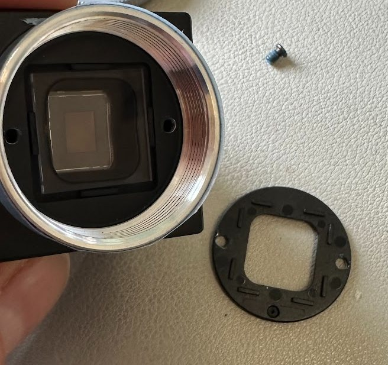
   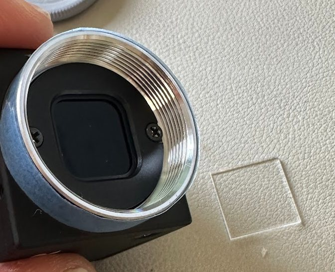

## An IR flashlight as illuminator

IR flashlights are useful to test setups, or even as permanent illuminators: they are powerful (5 W),
compact, and have adjustable focus. For example:
[940 nm](https://www.amazon.com/dp/B09C5YBZKS),
[850 nm](https://www.amazon.com/dp/B0C5QLKCR1),
[850 nm](https://www.amazon.com/dp/B07JR85TVH).

They run on 3 AAA batteries, which can be replaced by a 5 V DC power adapter
([example](https://www.amazon.com/dp/B08722QC75)), using DC pigtail cables to connect it
([example](https://www.amazon.com/dp/B072BXB2Y8)). The result plugs into a power outlet:

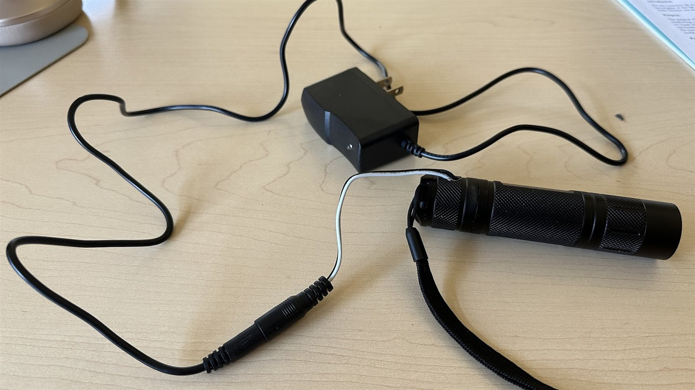

1. Drill a hole diagonally in the cap of the flashlight.

   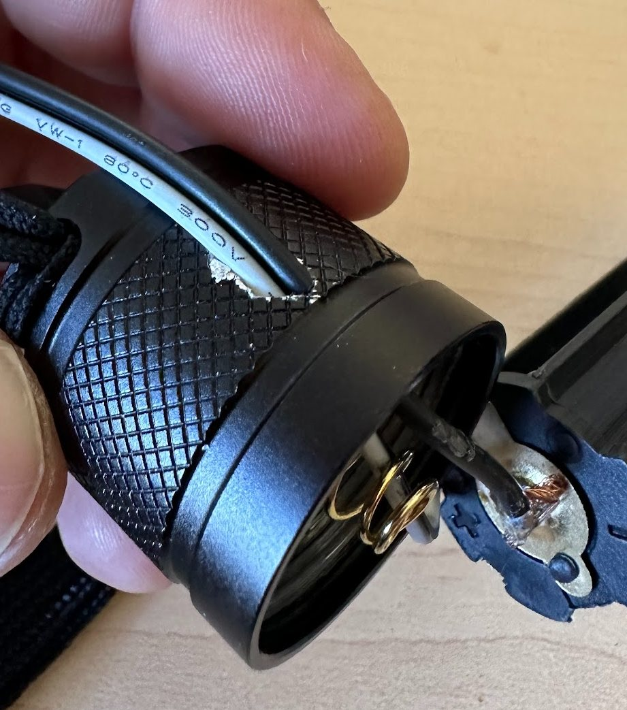
   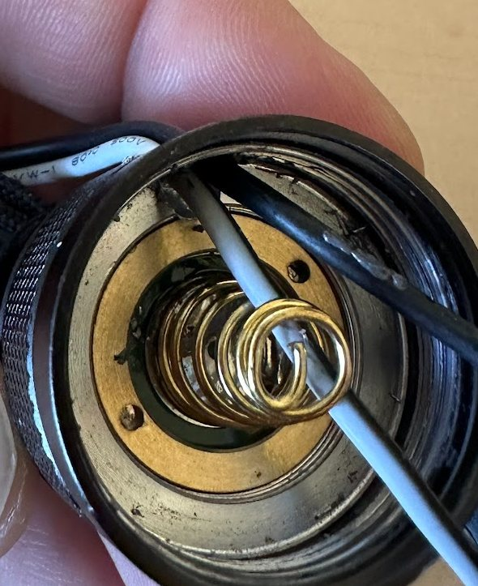

2. Pass the cable through the hole **before** soldering.
3. Solder the cable as in the picture. This needs the fewest changes and keeps the back button
   working.

   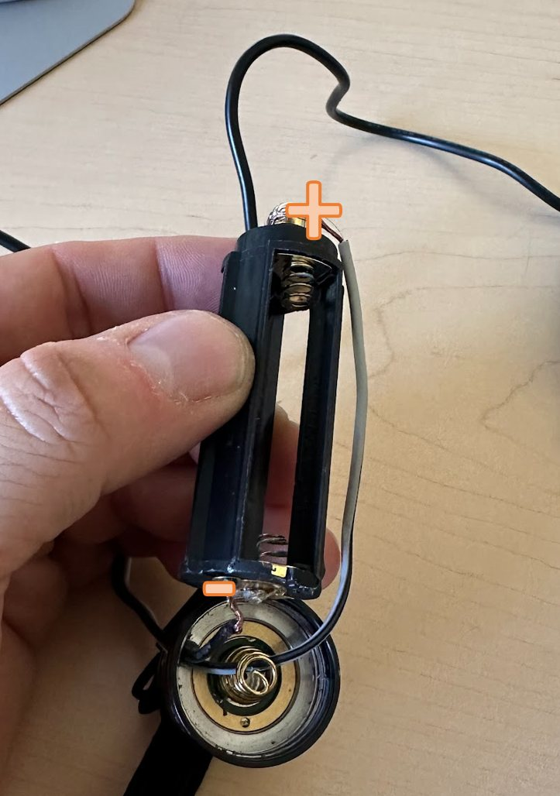

4. Put everything back together and close the cap.

   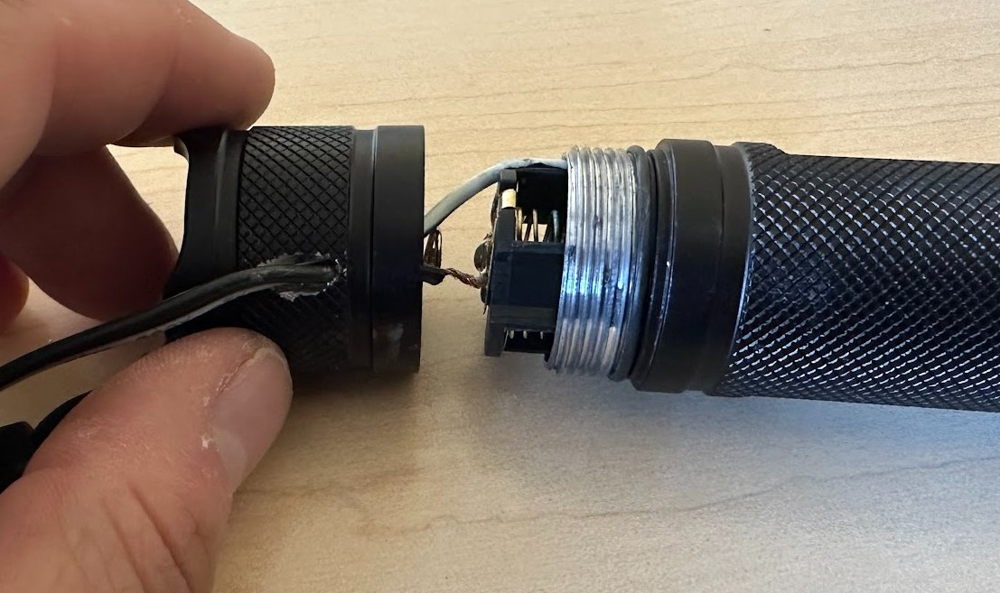

## Synchronized cameras

The **Spinnaker Dual Camera** system needs the two cameras wired together, so that one triggers the
other and both take each image at the same time. FLIR's application note:
[Configuring synchronized capture with multiple cameras](https://www.flir.com/support-center/iis/machine-vision/application-note/configuring-synchronized-capture-with-multiple-cameras/).

No extra circuitry or resistors are needed, and all cameras are wired the same way: the software can
pick any camera as the master. The wires of the GPIO cable (the line numbers are the ones the
software uses, not the connector pins):

| Color | Line | Function | Description |
| --- | --- | --- | --- |
| Black | 0 | Opto-in | Opto-isolated input |
| White | 1 | Opto-out | Opto-isolated output |
| Red | 2 | GPIO (or VOUT) | Non-isolated input/output (or power output) |
| Green | 3 | GPI (or VAUX) | Non-isolated input (or power input) |
| Blue | – | Opto GND | Opto-isolated ground |
| Brown | – | GND | Camera power ground |

Connect:

- **Ground:** all the **blue** and **brown** wires of all cameras together. This joins the isolated
  and non-isolated grounds, which the strobe signal below needs.
- **Trigger:** the **red** wires of all cameras together. This is the shared trigger line. The red
  line can be an input or an output, so the software sets the master's to output and the others' to
  input, with no special wiring for the master.
- **Strobe:** all the **white** and **green** wires of all cameras together. The green line is an
  input with an internal pull-up resistor (it floats at 3.3 V); the white line is an
  [open collector](https://en.wikipedia.org/wiki/Open_collector) output, which can pull it low. The
  master's white line drives the strobe signal on all the green lines.

## Synchronizing with other hardware

With the cameras wired as above, the **black** wire (line 0) is free to use as an input to
OpenIris, for example a signal from your stimulus computer. Connect the signal's ground to the brown
wires.

OpenIris records the state of the camera's input lines with **every frame**: 0 or 1 depending on
whether the voltage is above about 3.3 V. They are saved in the data file, and sent as `Int0` (left
camera) and `Int1` (right camera) in the extra data of [remote data replies](remote-control.md#the-data-reply-getdata-waitfordata).
To check it works live, turn on **Debug** and look at the Debug tab:

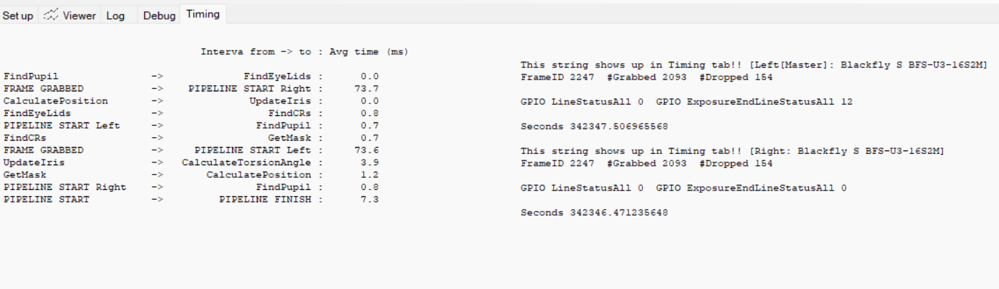

This is available in the **Spinnaker Dual Camera** and **Spinnaker Single Camera** systems. It needs
a recent camera firmware (next section).

To synchronize eye data with a stimulus display, see also
[OpenIrisSync](https://github.com/ocular-motor-lab/OpenIrisSync/wiki).

## Updating the camera firmware

Reading the input lines with every frame (`ExposureEndLineStatusAll` in the camera's chunk data)
needs firmware version **2306.0.653.0 or later**. Ask FLIR support for the firmware file for your
camera model if yours is older.

To install it, in SpinView:

1. Connect only one camera to the computer.
2. Open SpinView, right-click the camera and select **Update Device Firmware**.

   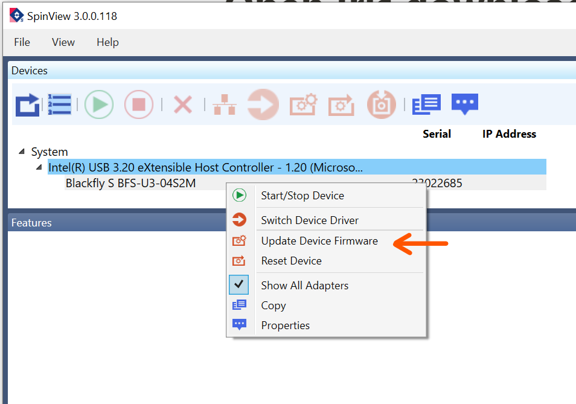

3. If the firmware version is older than 2306.0.653.0, click **Browse**, select the firmware file and
   install it.

   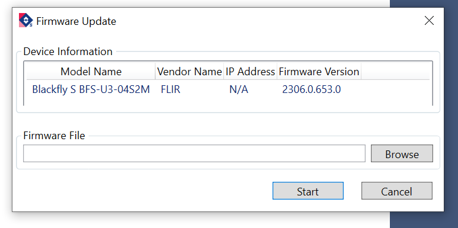

4. Repeat for the other camera.

## 3D printed parts

STEP files of the parts of our setup, ready to print, are in the [3d-parts folder](https://github.com/ocular-motor-lab/OpenIris/tree/main/docs/user-manual/3d-parts):

| File | Part |
| --- | --- |
| `Open_Iris_base.step` | Base |
| `Open_Iris_vertical_support.step` | Vertical support |
| `OpenIris_Tilt_support.step` | Tilt support |
| `Open_Iris_tilt_support_continuos.step` | Tilt support, continuous adjustment |
| `Open_Iris_tilt_support_stepped.step` | Tilt support, stepped adjustment |
| `Open_Iris_64mm_illuminator_holder.step` | Holder for a 64 mm illuminator |
| `Open_Iris_28.5mm_flashlight_holder.step` | Holder for a 28.5 mm IR flashlight |

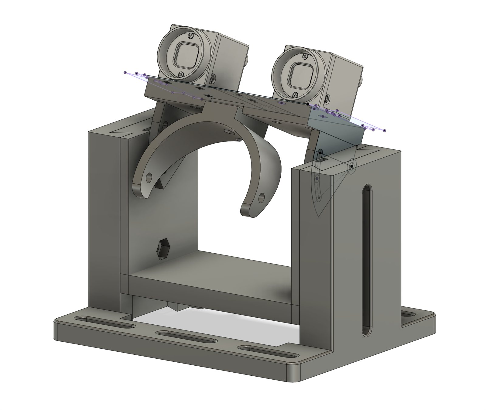

A desktop eye tracker for Blackfly S cameras:

