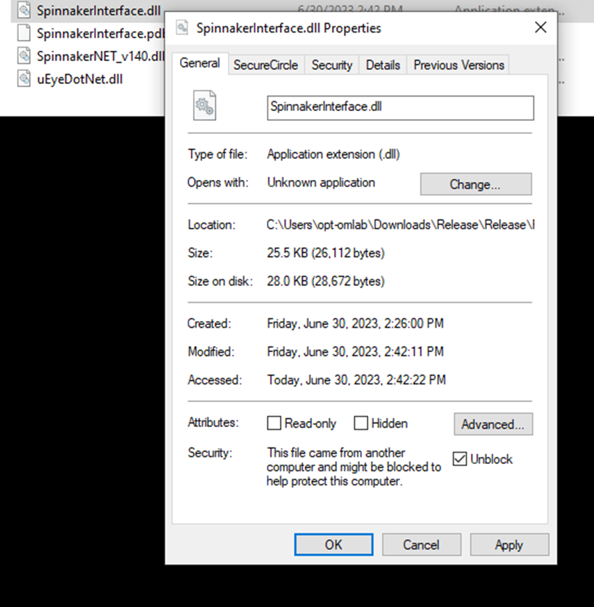
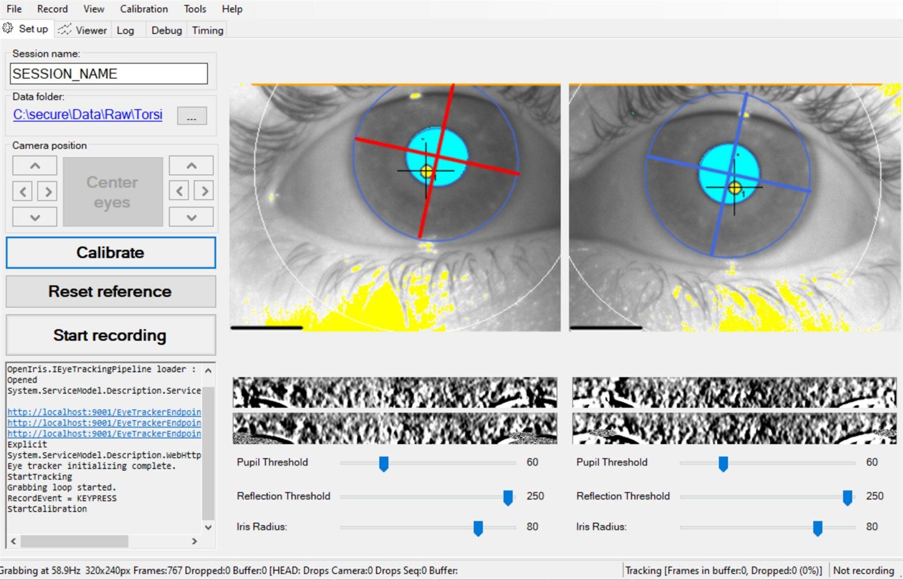
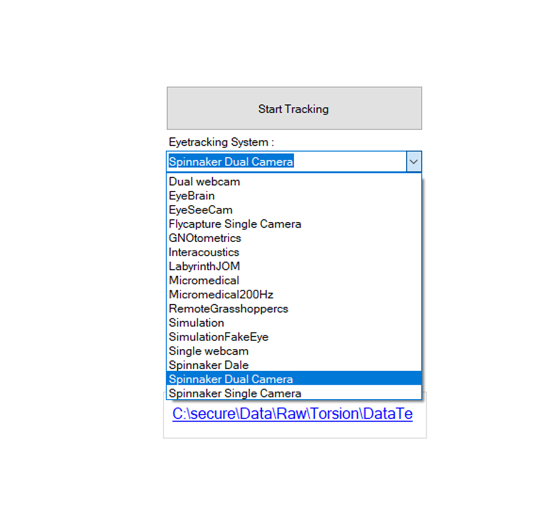

# Installing OpenIris

## Requirements

- **Windows 10 or later.** OpenIris doesn't run on macOS or Linux.
- **.NET Framework 4.8**, already present on almost all Windows computers.
- **A fast computer for high frame rates.** What you need depends on the frame rate and image size.
  For binocular recordings at 500 Hz, we recommend a recent Intel Core i9 (or similar) with a base
  frequency above 3 GHz.
- **For FLIR cameras:** install the [Spinnaker SDK](https://www.flir.com/products/spinnaker-sdk/)
  before running OpenIris, including its .NET libraries (the **Application Development** option of
  the installer). OpenIris uses the version you install. It also includes SpinView, which is very
  useful to test the cameras and solve problems with them.

  > [!NOTE]
  > OpenIris 0.1.6 and earlier need exactly version 3.0.0.118 of the Spinnaker SDK.
- **For older FLIR (Point Grey) cameras that use FlyCapture** (the Flycapture Single Camera,
  RemoteGrasshoppercs and Micromedical systems): install the FlyCapture SDK, version 2.13.3.61, the
  last one, from FLIR's website. OpenIris uses its .NET library (`FlyCapture2Managed_v140.dll`)
  from the installed SDK.

See [Hardware](hardware.md) for the cameras, lenses and illuminators we use.

## Download and set up

1. Download the latest release from
   [github.com/ocular-motor-lab/OpenIris/releases](https://github.com/ocular-motor-lab/OpenIris/releases).
   Download the zip file named `OpenIris_Win_Release_…`, not the source code.
2. Unzip it into a folder of your choice, for example `C:\OpenIris`.
3. Double-click `OpenIris.exe`.

### Versions before 0.1.6: unblock the plugins

Windows marks files downloaded from the internet, and OpenIris versions before 0.1.6 can't load
plugins marked that way. The **Eyetracking System** list then only shows a couple of options. To
avoid it, **before unzipping**, right-click the zip file, **Properties**, check **Unblock**, **OK**.
The extracted files are then not marked.

If you already unzipped it, unblock the files instead. In PowerShell, from the OpenIris folder:

```powershell
Get-ChildItem -Recurse -Filter *.dll | Unblock-File
```

Or for each `.dll` file in the `Plugins` folder: right-click it, **Properties**, check **Unblock**,
**OK**.



## First run: the Simulation system

You can try OpenIris without a camera. The Simulation system plays a recording of two eyes as if it
came from two cameras.

1. In **Eyetracking System**, select **Simulation**.
2. Click **Start Tracking**.

The default pipeline starts tracking the pupil, the corneal reflection and torsion of both eyes.

The Simulation system plays two short sample videos included with OpenIris (in the `SampleVideos`
folder). It can also play your own: set **LeftEyeVideo** and **RightEyeVideo** in its settings
([configuration](configuration.md), System settings), and **VideoOrientation** to **Upright** for
videos recorded with OpenIris. Unlike Play video, Simulation acts like live cameras, so it is useful
to test a setup or a stimulus program without a subject.



From here, see [Configuration](configuration.md) to adjust OpenIris to your setup, and
[Tracking and recording](tracking-and-recording.md) to record data.

## With cameras

Select the eye tracking system for your cameras and click **Start Tracking**:

- **Spinnaker Dual Camera**: two FLIR cameras, one per eye, synchronized. The two cameras must be
  connected with the synchronization cable (see [Hardware](hardware.md#synchronized-cameras)), or
  OpenIris won't start.
- **Spinnaker Single Camera**: one FLIR camera, for one eye or both eyes in the same image.



The first time, OpenIris may ask for the cameras' serial numbers: accept and continue. If the left
and right cameras turn out to be swapped, swap their serial numbers in the configuration.
