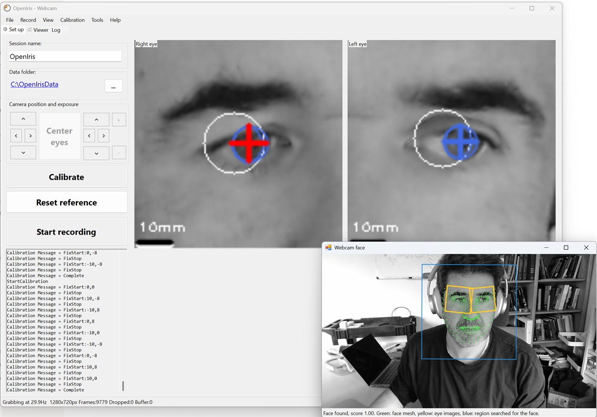

# Webcam tracking

OpenIris can track the eyes with an ordinary webcam that films the face. It is much less precise
than an infrared eye tracker, but it needs no special hardware, so it is useful for trying OpenIris,
for demonstrations, and for experiments where a few degrees of error are acceptable.

> [!WARNING]
> Webcam tracking is new and experimental. Its accuracy has not been measured yet.

## How it works

It uses neural networks from Google's [MediaPipe](https://github.com/google-ai-edge/mediapipe):

1. A face detector finds the face, only at the start or when the face was lost.
2. A face mesh finds 468 points on the face in every frame, including the corners of the eyes.
3. For each eye, OpenIris cuts an image out of the webcam image, centered between the eye corners,
   level, and always at the same scale. These eye images, shown in the main window, look like the
   images of a head-mounted eye tracker: the eye stays still in them when the head moves.
4. The iris network finds the iris and the eyelids in each eye image.

In visible light the pupil is hard to see, so the **iris** center stands in for the pupil center,
and the iris diameter for the pupil size, in the data file.

## Setting it up

1. Connect the webcam and place it below or above the screen, facing the subject, about 50–70 cm
   away. The face should fill a good part of the image: the more pixels on the eyes, the better.
2. Light the face evenly from the front. Avoid a bright window behind the subject.
3. Select the **WebcamMediaPipe** [profile](configuration.md#settings-profiles) on the main window. It
   uses the `Webcam` eye tracking system and the `Webcam iris` pipeline.
4. Start tracking. The two eye images appear once the face is found, with the iris circle and the
   eyelids drawn on them.

A separate **Webcam face** window also opens, showing the whole webcam image with the face mesh
(green), the regions cut out as eye images (yellow), and the region searched for the face (blue).
Use it to check the framing and the lighting, and to see why tracking fails. It closes when tracking
stops; turn it off with `ShowFaceView`.

When the webcam starts, the log lists the webcams found and every format, resolution and frame
rate the one in use can send, followed by what it opened with. If the frame rate is lower than
expected, check there: many webcams give their high resolutions at full frame rate only in the
compressed MJPG format, which OpenIris asks for.

Settings of the Webcam system:

| Setting | Default | Meaning |
| --- | --- | --- |
| `CameraIndex` | 0 | Which webcam, if there are several (0 is the first). |
| `ResolutionWidth`, `ResolutionHeight` | 1280 × 720 | Resolution to ask the webcam for. Webcams choose the closest one they support. |
| `FrameRate` | 30 | Frame rate to ask for. Most webcams give 30 fps. |
| `EyeImageSize` | 256 | Size in pixels of each eye image. Only changes what the eye images show: the iris model always works on 64 × 64. |
| `ShowFaceView` | on | Open the Webcam face window when tracking starts. |
| `HorizontalFieldOfView` | 65 | Horizontal field of view of the webcam in degrees, for the head position (see below). |

## The data

Positions are in pixels of the eye images. The eye images are 2.3 times wider than the distance
between the eye corners, so with the default size of 128, one pixel is about 0.5 mm on the eye.
Because the eye images follow the head, head movements mostly don't change the iris position.

Recordings save the whole webcam image. They can be [processed again](processing-videos.md)
choosing the Webcam system.

### Appearance gaze

> [!WARNING]
> Experimental, and not tested with a live webcam yet.

Instead of the iris position, the gaze can come from the appearance of both eyes, with the
eye-embedding network of [saccade.js](https://saccade.jspsych.org). It looks at an image of both eyes
(144 × 36 pixels, cut out around points of the face mesh) and gives a list of 128 numbers that
change with where the eyes look. Those numbers mean nothing until they are calibrated: an
[N-point calibration](calibration.md#n-point) with **SignalSource** `Appearance` maps them to the
targets, as saccade.js does (a ridge regression on every frame of every target), and the calibrated
horizontal and vertical positions (`H`, `V`) come from it. Both eyes get the same gaze. The 128
numbers are not saved in the data file, so to calibrate a recording again it has to be
[processed again](processing-videos.md).

To use it:

1. Select the **WebcamSaccadeJS** profile. It is the WebcamMediaPipe profile with `AppearanceGaze`
   on in the settings of the `Webcam iris` pipeline, and the N-point calibration set up as below.
2. The network is slow: with the face and the irises, a frame takes about 250 ms. Raise
   `MaxNumberOfProcessingThreads` so frames are processed in parallel (the face is still followed
   one frame at a time). On a computer with 16 cores, 7 threads process about 12 frames per second
   (the 20 seconds of the iPhone sample video in about 50 seconds), so live tracking at 30 frames
   per second drops frames. Record the video and [process it](processing-videos.md) afterwards
   for every frame.
3. Calibrate: N-point with **SignalSource** `Appearance`, 13 targets shown by OpenIris (Local mode,
   on the display `StimulusDisplay` of the Webcam system). Use at least 9 targets.

saccade.js reports no accuracy for the network, and suggests measuring it for each participant.
Validate after calibrating.

### Head pose

From the face it finds, OpenIris also estimates the pose of the head, fitting a generic face to six
points: the nose tip, the chin, the outer corners of the eyes and the corners of the mouth. It fills
the head columns of the [calibrated data file](data-file.md#calibrated-data):

- `HeadYaw`, `HeadPitch` and `HeadRoll`, in degrees, relative to the head at the reference:
  **Calibrate** or **Reset reference** zero them, with the eyes. Before there is a reference, they are
  relative to facing the camera. Expect an accuracy of a few degrees.
- `HeadX`, `HeadY` and `HeadZ`, in mm, from the camera: to the subject's right, up, and the distance
  to the camera. The distance is approximate: it depends on `HorizontalFieldOfView`, the field of
  view of the webcam across the image as recorded (narrower for a phone video recorded upright). Set
  it from the webcam's specifications to get closer distances. It also assumes an average face.

In frames where the face isn't found, the head columns are `NaN`.

## Limitations

- **Precision**: with 640×480 images, the eyes are only about 30 pixels wide, so expect noisy
  data. Higher resolutions help.
- **Frame rate**: about 30 fps. Finding the face takes ~15 ms per frame and each iris ~10 ms.
- **Timing**: webcams don't give timestamps or frame counters, so OpenIris uses the time each image
  arrives, and can't tell when the webcam itself dropped frames.
- **Blinks**: the networks always return an eye, so during a blink the iris position is not
  reliable. The eyelid positions show when the eye is closed.
- **Glasses** with strong reflections and faces turned far to the side make tracking worse.

The MediaPipe networks are licensed under the Apache License 2.0, and saccade.js's network under
the MIT license; copies of both are in `Plugins\WebcamModels\`. Where they come from and how they were converted is described in
`source\BasicPlugins\Webcam\Models\README.md`.
